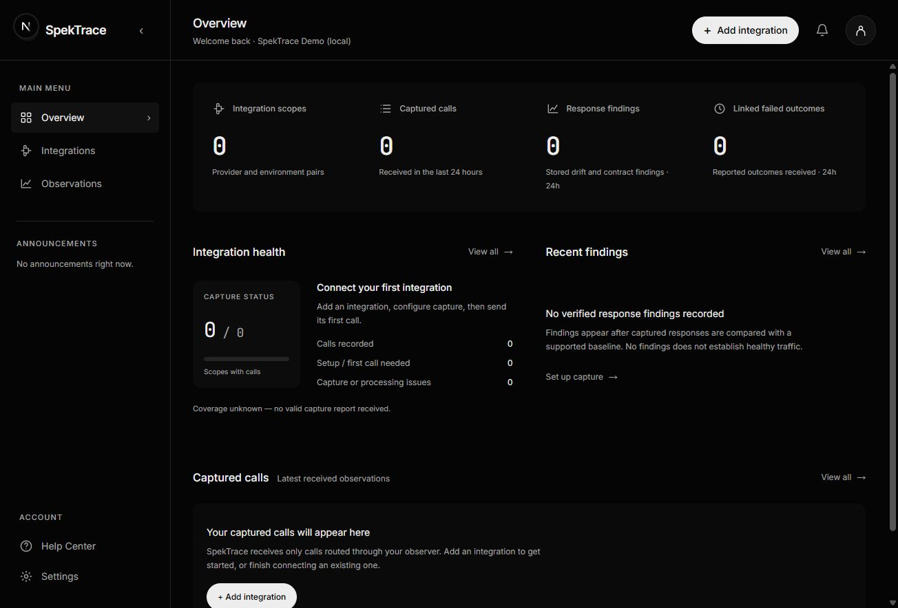

# SpekTrace (Spek)

SpekTrace helps developers investigate changes in third-party APIs and the workflows that depend on them. Capture outbound API calls, compare selected response fields with a baseline or contract, and inspect explicitly linked workflow outcomes.

**Status: early, self-hosted MVP.** You run the application, PostgreSQL, Redis and background worker yourself. Local review works without external accounts. Google sign-in, email and Slack require your own provider configuration. Production deployment, retention enforcement and performance benchmarking remain work in progress.



The screenshot shows an empty local workspace. An integration must send observations before real activity appears.

## Features

- **API observations:** captured HTTP results, time to headers or error, timeouts and connection failures from calls made through the server-side observer.
- **Response drift detection:** selected field presence and type comparisons against explicitly activated, versioned baselines or supported OpenAPI response contracts.
- **Workflow outcomes:** identifier-based links between API calls and explicitly reported successful, failed or cancelled workflow attempts.
- **Investigation:** inspect changed fields, baseline provenance, related calls, reported outcomes and capture gaps.
- **Integration onboarding:** add several integrations, connect them individually, resume setup and add more later.
- **Notifications:** Slack, email or both; alert-category controls; grouped findings; daily or weekly digests; test delivery and delivery history. The header bell opens queued notification records and links to compact alert views.
- **Optional accounts:** Google and verified email/password sign-in with account-owned workspaces.
- **Operator tools:** terminal status checks, owner-only platform announcements, and retained request validation, webhook/Stripe evidence and audit records.

## Requirements

- Node.js **24**, matching [`.nvmrc`](.nvmrc), and npm.
- Docker with Docker Compose for the bundled PostgreSQL 16 and Redis 7 services, or separately managed compatible services.
- Available local ports: `3000` for the app, `5432` for PostgreSQL and `6379` for Redis. The disposable synthetic review uses `3004`.

The supplied database credentials and Compose configuration are for local development. The app and worker run on your host; Compose starts PostgreSQL and Redis only.

## Quick start

These steps initialize a **new local development installation**. If you already have a database, back it up and inspect its configuration before applying migrations. Do not reset or reseed an existing installation to follow this guide.

### 1. Clone and configure

Clone this repository and open its directory in a terminal.

Create your private `.env` file from the example. Do not overwrite an existing `.env`.

PowerShell:

```powershell
Copy-Item .env.example .env
```

macOS/Linux:

```sh
cp .env.example .env
```

Keep the example `DATABASE_URL` and `REDIS_URL` if you are using the bundled Compose services. Leave `SPEKTRACE_ACCOUNTS_ENABLED=false` for the local quick start. Accounts are configured separately below.

Generate an internal admin token on your own computer:

```sh
node -e "console.log(require('node:crypto').randomBytes(32).toString('hex'))"
```

Paste that value into `SPEKTRACE_INTERNAL_API_TOKEN` in your private `.env`. Keep it out of source control, browser code and shared logs. This admin token is separate from the ingestion credential used by an instrumented application.

### 2. Install dependencies

```sh
npm ci
```

The install runs Prisma client generation. If you later change the Prisma schema or update generated clients, run `npm run db:generate` and restart the app and worker.

### 3. Start PostgreSQL and Redis

```sh
npm run infra:up
npm run infra:check
```

Wait for the services to become ready before proceeding. If ports or container names are already in use by another SpekTrace installation, use that installation deliberately or configure separate services instead of replacing its data.

### 4. Apply migrations and initialize the local workspace

For this new local database:

```sh
npm run db:migrate:deploy
npm run db:seed
npm run pilot:print-workspace-id
```

The seed creates the local review workspace and sample request-validation evidence. It does not connect a provider or generate outbound API traffic.

Copy the workspace UUID printed by the last command into `SPEKTRACE_INTERNAL_WORKSPACE_ID` in `.env`, replacing the example UUID.

### 5. Start the app and worker

In one terminal:

```sh
npm run dev:local
```

In another terminal, from the same repository directory:

```sh
npx tsx --tsconfig scripts/tsconfig.server.json src/workers/index.ts
```

The worker launch above uses the repository's server configuration so its server-only imports resolve correctly.

Open [http://127.0.0.1:3000/dashboard](http://127.0.0.1:3000/dashboard).

The local dashboard is available without sign-in while account mode is off. Keep this mode restricted to your trusted local machine. The worker processes observations, outcome links, queued notifications and retained request/webhook jobs. Keep both processes running while testing capture.

## Connect your first integration

1. Open **Integrations**, then use **Add integration** in the header. Initial multi-integration setup is available at `/dashboard/onboarding`.
2. Enter a nonsecret integration label, provider label and environment. Saving these details records setup intent; it does not automatically connect a provider.
3. Issue a workspace ingestion credential using the operator CLI:

   ```text
   npm run ingestion:credentials -- issue --workspace WORKSPACE_UUID --name "My integration" --secret-file ABSOLUTE_PRIVATE_FILE_PATH
   ```

   Replace both placeholders. The secret file must be a new file in an existing private directory inside your user profile, outside the repository. The CLI saves the token there without printing it. See the [credential guide](docs/ingestion-credentials.md) for file-permission requirements, listing, rotation and revocation.

4. Configure `createOutboundObserver` in your application's server code with the collector origin, ingestion token, fixed provider origin and the same integration/provider/environment labels. Route a call through `observer.fetch(...)`, then explicitly flush delivery at an appropriate lifecycle boundary.
5. Confirm the call in **Observations**. Enable selected response pointers only for the field types and presence checks you need. Create and activate a response baseline before expecting drift comparisons.
6. To inspect downstream impact, report the workflow's actual final outcome separately using the matching correlation identifier and attempt. HTTP success alone does not establish workflow success.

The outbound observer is currently a server module inside this checkout, not a published, separately installable SDK. Integration into another application requires wiring that module into its server runtime. The retained Express monitoring package observes inbound 4xx requests; it is a separate capture path.

See the [integration guide](docs/integration-observability.md) for the observer API, examples, baseline commands, sampling, privacy boundaries and outcome-linking rules.

## Try a synthetic review

To inspect a populated dashboard without connecting a real provider, first create the separate test database specified by `.env.example`, then start the disposable review:

```sh
npm run db:ensure
npm run review:integration-observability
```

This starts synthetic payment and CRM scenarios at [http://127.0.0.1:3004/dashboard](http://127.0.0.1:3004/dashboard), using its own temporary database and queue namespace. It expires after 15 minutes and removes its temporary database and server. It does not populate your normal workspace. The configured test database owner needs permission to create and drop databases.

## Accounts and notifications

### Optional sign-in

Configure the private values described in [account and notification setup](docs/onboarding-notifications.md):

- `BETTER_AUTH_SECRET` and the canonical `BETTER_AUTH_URL`.
- Google OAuth credentials for Google sign-in. The registered callback is your canonical origin plus `/api/auth/callback/google`.
- A Resend API key and verified sender for email verification and password reset.

Then enable `SPEKTRACE_ACCOUNTS_ENABLED=true` and restart the app and worker. Verified accounts receive their own workspaces; they do not automatically inherit the local review workspace. Email/password accounts require email verification. Automatic linking between different sign-in methods is disabled.

### Alerts and digests

Open **Settings → Notifications** to choose Slack, email or both, select alert categories, choose an optional daily or weekly digest, and review or test delivery.

Destinations must be configured privately on the server before enabling delivery. In account mode, Slack destinations are scoped to their workspace and email targets the verified workspace owner. Test notifications send real messages when enabled and configured.

The header bell shows retained alerts, digests and test notifications when they are queued. It supports older records through pagination. Delivery status describes the sending attempt, not whether a person has read the notification. Opening an item shows its compact alert view, with a link to the full investigation.

### Platform announcements

Only the verified account designated by `SPEKTRACE_PLATFORM_OWNER_ID` can see announcement publishing controls. Other users see published announcements only. Publishing is disabled when accounts or the owner designation are not configured. See [announcement setup](docs/dashboard-announcements.md).

### Terminal status

With the internal admin token and workspace configured, the operator can check status without opening the dashboard:

```sh
npm run status
npm run status -- --json
```

This is an operator command, not an end-user account-session CLI.

## Limits and privacy

- **Instrumented calls only:** SpekTrace captures calls made through its observer. Counts and coverage reports do not represent complete application traffic or provider uptime.
- **Selected fields only:** response shape capture is off by default. Opt-in collection retains selected field presence and JSON types, not field values. It does not infer field renames or discover every schema change.
- **Bounded collection:** up to 16 selected pointers, depth 6, a 32 KiB JSON read and 100 elements per selected array. Oversized, unsupported and incomplete checks remain distinct from successful comparisons.
- **Limited contract support:** stored OpenAPI 3.1 response comparisons support selected inline JSON type/presence checks. References, composition and exhaustive JSON Schema validation are outside this detector's scope.
- **Explicit association:** outcome links use matching identifiers and attempts. Timing alone is insufficient; a linked failed workflow does not prove the API call caused it.
- **Delivery gaps are possible:** the observer has no durable client-side spool. Explicit flushing, process shutdown and delivery failures affect what reaches the collector. Notification retries can duplicate a message after an uncertain acknowledgement.
- **Operator-managed metadata:** labels and correlation aliases must themselves be nonsecret. The selected-field collection policy does not make arbitrary operator-supplied metadata safe.
- **Deployment work remains:** automatic retention/purge, production load benchmarks and independent production security verification are not complete. Account rate limits are per process; multi-instance deployments need shared rate-limit planning. Announcements need persistent shared storage when deploying across instances.

Response comparisons and outcome investigation use deterministic evidence. Optional retained AI investigation/proposal features are separate, disabled by default and unnecessary for the core observation workflow.

## Development and verification

Basic checks:

```sh
npm run typecheck
npm run lint
npm run build
```

For isolated observation and notification verification, configure a distinct `TEST_DATABASE_URL` whose database name includes `spektrace_test`. With the bundled local services, `npm run db:ensure` creates the example test database if needed.

```sh
npm run db:ensure
npm run verify:integration-observability -- --mvp-cleanup --unit --build
npm run verify:notifications
```

These verification wrappers create and drop their own temporary databases. They require database-create/drop permission and use synthetic fixtures; they do not establish real-provider coverage or production readiness. The notification verifier uses simulated Google/mail/Slack boundaries and does not send external messages.

Avoid running broad database-resetting integration suites against development or shared databases. Older real-model verification commands are separate opt-in workflows and are not required to run SpekTrace.

## Contributing

Use the repository's Issues tab for bug reports and proposals. Include reproduction steps, expected behavior and sanitized evidence. Never include credentials, private payloads or customer data.

Keep changes focused, describe how they were checked, and preserve the distinction between HTTP results, structural findings and workflow outcomes. Check [AGENTS.md](AGENTS.md) for repository conventions. Detailed historical verification reports remain under [`docs/verification`](docs/verification).

## License

Released under the [MIT License](LICENSE).
